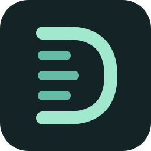

# Datsumi — Database Explorer

**Every database. One workspace.**

A focused database client inside VS Code: connect, browse, query, inspect relationships and review changes without leaving your editor. SQL, documents and keys share one workspace; capabilities vary by engine.

## Start

Install a Datsumi VSIX using **Extensions → … → Install from VSIX**. Open Datsumi in the Activity Bar and use the single **+ → Add Database Connection**. Enter a database file or server details, test, then connect. Optional drivers install automatically; npm is not required. Credentials remain separate from profiles and can use VS Code SecretStorage.

Use a table/collection/key to browse data, or **New Query → Ctrl/Cmd+Enter**. Results appear in the bottom **Query Results** panel. The sidebar's collapsed **History** view lists previous queries and their database. SQL completion/formatting use the selected connection.

For SQL grid edits: **stage cells/rows → Review SQL → Commit changes → native confirmation**. Conflicts roll back supported transactional batches. Server captures require a complete schema-qualified single-table SELECT *; views, unsafe/ambiguous targets and shortened originals stay protected. ClickHouse grids are read-only. MongoDB/Redis use their reviewed document/key workflows.

**Server access warning:** _Disable grid editing_ only affects staged edits. Editor SQL always uses your database account permissions. Use a database-enforced read-only account to prohibit all writes. SQLite/DuckDB file read-only mode is enforced by their engines.

## Supported engines

SQLite, DuckDB, PostgreSQL, MySQL, MariaDB, SQL Server, Oracle, ClickHouse, MongoDB, Redis, libSQL and Turso. Neon and Supabase reuse PostgreSQL presets. See the [support matrix](docs/support-matrix.md) for tested versions, authentication, transactions, platforms and cloud limitations. A supported protocol is not a promise of every provider feature.

## Everyday tools

- Multiple results, pinning/renaming, sorting, paging, inspectors, comparisons and full-result copy within documented memory budgets.
- **Cmd/Ctrl+A → Cmd/Ctrl+C** copies all available data as clean TSV; add Shift to A to include column names. Types, statistics and UI elements are excluded.
- CSV/JSON export, bounded staged CSV import, exact integer/JSON/BSON preservation, and optional spreadsheet-safe CSV. Exact clipboard transfer remains unchanged.
- Schema relationships, foreign-key navigation, SQL completion/formatting, history/favorites and native SQL files.
- Connection edit/duplicate, SSH tunneling with host-key trust, verified TLS, environment labels and redacted diagnostics.
- SQLite create/open and online backup. Pending table drafts can be saved to a file; optional local reload recovery is off by default and never auto-applies.

## Customize

Open Settings and search **`@ext:philipp-manhart.datsumi`**. Choose grid density/page size/type labels/NULL display; SQL keyword casing/spacing/completion; history limits/expiry; credential defaults; CSV safety; and optional draft recovery. [Settings guide](docs/settings.md) describes defaults, scope and privacy implications. Native VS Code themes/fonts remain in control.

## Develop and verify

```sh
bun install --frozen-lockfile
bun run check
bun run --cwd apps/extension build
```

Use F5 → **Debug Datsumi Extension**. Samples are generated locally with `bun run sample:db`, `bun run sample:duckdb` or `bun run sample:nosql`; see [sample data](samples/README.md). Do not use production databases for tests.

Before publishing run the explicit local [release checklist](docs/release-checklist.md). **GitHub Actions and automatic Git hooks are intentionally absent.** The release command runs real-engine/native tests, audits, secret scans, packaging and artifact checks; a dirty-tree report cannot approve publication.

- [Contributing](CONTRIBUTING.md) · [Testing](docs/testing.md) · [Support matrix](docs/support-matrix.md)
- [Privacy](PRIVACY.md) · [Security](SECURITY.md) · [Support](SUPPORT.md)
- [Connection troubleshooting](docs/connection-troubleshooting.md) · [License audit](docs/license-audit.md)
- [Detailed feature reference](docs/feature-reference.md) · [Changelog](apps/extension/CHANGELOG.md)

## License

Datsumi's own code, documentation and original logo are [MIT](LICENSE). Bundled dependencies and assets retain their own licenses and required notices. Database server/container licenses are separate; servers are not distributed in the extension.
