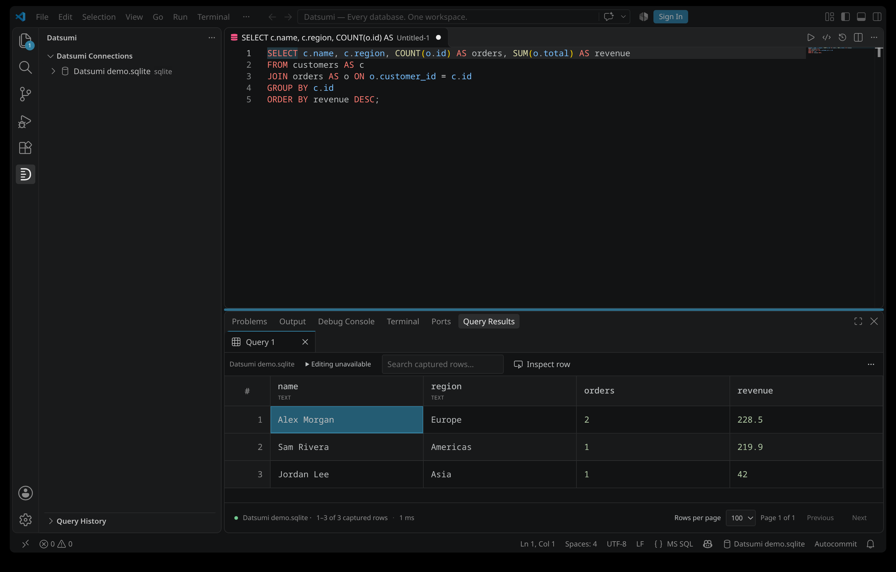
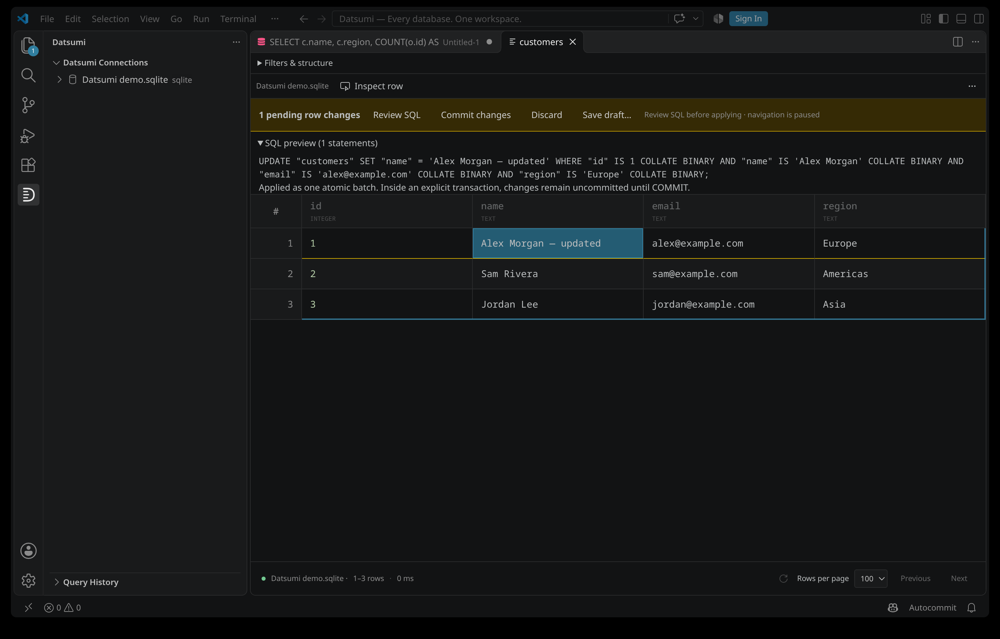
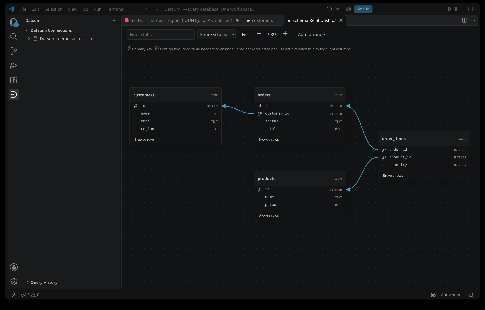

# Datsumi — Database Explorer

**Every database. One workspace.**

Explore tables, write queries, browse documents and inspect keys without leaving VS Code. Datsumi brings your everyday database work into a focused workspace that follows your editor's theme.

**Free and open source under MIT. All features included. No Pro edition, subscription, or Datsumi account.**

## Your everyday database tools

- **Write SQL in your editor.** Connection-aware table and column suggestions, keyword completion, formatting, query plans, and Ctrl/Cmd+Enter to run.
- **Keep results within reach.** A bottom results panel with multiple tabs, pinning, names, sorting, paging, search, column controls, and record/JSON inspectors.
- **Copy straight into a spreadsheet.** Ctrl/Cmd+A → Ctrl/Cmd+C copies data across result pages as clean TSV. Add Shift to A for column names. UI labels, types, and statistics stay out of the clipboard.
- **Review before you write.** Stage several SQL cell/row edits, inspect the generated SQL, then explicitly commit. Supported transactional batches use conflict detection; document/key changes have their own review workflow.
- **See how tables connect.** Explore declared foreign keys in a relationship diagram, rearrange tables, and jump into their data.
- **Pick up where you left off.** Find queries by database in the sidebar's Query History, save favorites, and reopen SQL without executing it.

## Changes you can review

Editing a grid does not immediately update the database. Stage your changes, choose **Review SQL**, then **Commit changes** and confirm. Views, keyless tables, ambiguous query results, and unsupported targets explain why editing is unavailable. ClickHouse grids are read-only.

## Relationships, at a glance

Use **View Relationships** from a connection or table to explore the schema. Filter to a table, follow declared foreign keys, and browse the connected data.

## SQL, documents, and keys

**Relational:** SQLite · DuckDB · PostgreSQL · MySQL · MariaDB · SQL Server · Oracle · ClickHouse · libSQL · Turso.

**Documents and keys:** MongoDB · Redis.

Neon and Supabase connection presets reuse PostgreSQL support. Capabilities and authentication modes vary by engine and deployment; see the [support matrix](https://github.com/Philipp-Manhart/datsumi/blob/main/docs/support-matrix.md).

## Get started

1. Install Datsumi, then open its icon in the Activity Bar.
2. Click **+ → Add Database Connection**. Choose a database file or enter server details, test the connection when available, and connect.
3. Open a table to browse, or choose **New Query** and press **Ctrl+Enter** on Windows/Linux or **Cmd+Enter** on macOS.

Results appear beside Terminal in the bottom panel. Query History is in the sidebar. **Datsumi: Getting Started** opens a short walkthrough; **Datsumi: Help and Privacy…** opens guides bundled with the extension, even offline.

Before the first Marketplace release, install the `.vsix` from [GitHub Releases](https://github.com/Philipp-Manhart/datsumi/releases) through **Extensions → … → Install from VSIX…**.

## Fits your workspace

Datsumi is built for desktop VS Code on **Windows, macOS, and Linux**, including remote extension hosts. Use VS Code **1.138.0 or newer** in a trusted workspace. End users do not need npm, a compiler, or a separate Node installation. JavaScript drivers are bundled; DuckDB downloads a verified native package for your platform on first use.

Choose compact or comfortable rows, page sizes, type labels, NULL display, SQL formatting, and history retention in Settings: **`@ext:philipp-manhart.datsumi`**. Your existing default SQL formatter is preserved; use **Format SQL** directly or explicitly select Datsumi as your formatter.

## Your connections and data

Credentials can stay in session memory or use VS Code SecretStorage. SSH tunneling supports key/agent authentication and host-key verification; supported secure database transports verify TLS by default. Datsumi has no application analytics backend or account service.

History is local, unencrypted query text; you can disable or clear it. Persisted edit-draft recovery is optional and off by default. Exact clipboard copying has explicit memory limits; incomplete captures are refused rather than silently copied. Use filtered-table export for larger transfers, or spreadsheet-safe CSV for untrusted formula-like text.

For server databases, disabling grid editing does not restrict SQL permissions. Use a database-enforced read-only account when writes must be prohibited. [Privacy details](https://github.com/Philipp-Manhart/datsumi/blob/main/PRIVACY.md).

## Open source, with everything included

Datsumi's source is [MIT-licensed](https://github.com/Philipp-Manhart/datsumi/blob/main/LICENSE). There is one edition: no feature unlocks or paid Pro tier. Dependencies retain their own licenses and notices.

[Source & contributions](https://github.com/Philipp-Manhart/datsumi) · [Report a bug](https://github.com/Philipp-Manhart/datsumi/issues) · [Settings](https://github.com/Philipp-Manhart/datsumi/blob/main/docs/settings.md) · [Connection help](https://github.com/Philipp-Manhart/datsumi/blob/main/docs/connection-troubleshooting.md) · [Security reporting](https://github.com/Philipp-Manhart/datsumi/blob/main/SECURITY.md)
